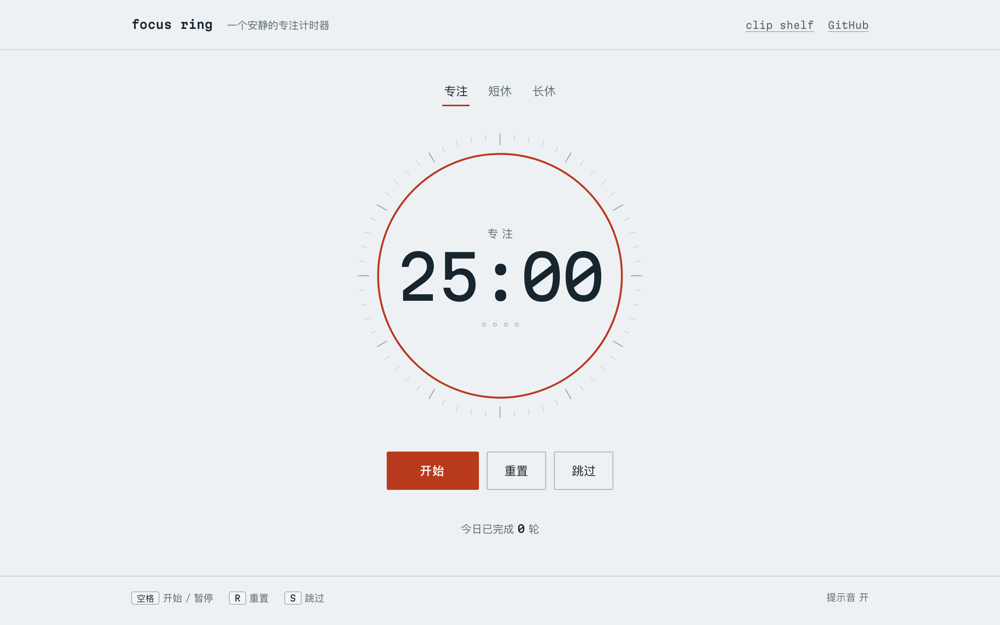
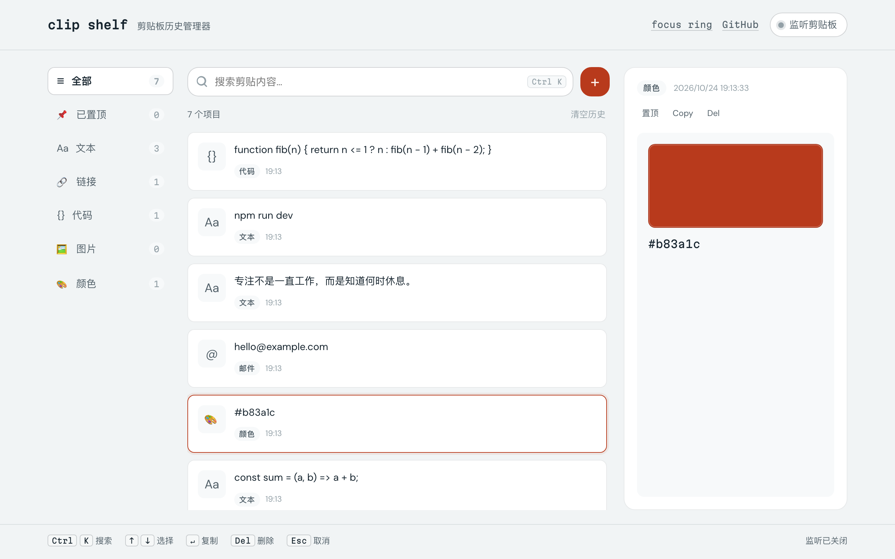

# focus ring · clip shelf

这个仓库里放两个零依赖的小工具：一个专注计时器，一个剪贴板历史管理器。都是原生 HTML/CSS/JavaScript，没有构建步骤，打开就能用。

| 工具 | 入口文件 | 在线地址 |
| --- | --- | --- |
| focus ring 专注计时器 | `index.html` | <https://ayaseeli-bing.github.io/focus-ring/> |
| clip shelf 剪贴板历史 | `clipboard.html` | <https://ayaseeli-bing.github.io/focus-ring/clipboard.html> |

两个页面在顶栏互相链接，也可以直接用 GitHub 上的源文件。

## focus ring



### 功能

- **25 分钟专注**，完成后自动切到 5 分钟短休；每完成四轮专注，进入 15 分钟长休。
- **仪器式表盘**：60 格刻度环与红色进度弧，剩余时间一眼可见。
- **今日统计**：完成的轮数保存在本地，刷新页面不会丢失。
- **提示音**：阶段结束时轻轻响两声，可随时关闭。
- **键盘可用**：空格开始 / 暂停，R 重置，S 跳过。
- **响应式**：桌面和手机都能完整使用，并遵循系统的减少动态效果设置。

### 轮次规则

| 阶段 | 时长 | 触发时机 |
| --- | --- | --- |
| 专注 | 25 分钟 | 手动开始 |
| 短休 | 5 分钟 | 第 1–3 轮专注完成 |
| 长休 | 15 分钟 | 第 4 轮专注完成 |

长休结束后，本轮进度清零。跳过专注会直接进入短休，且不计入今日完成数；跳过休息会回到专注；跳过长休会清零本轮进度。

### 快捷键

| 按键 | 动作 |
| --- | --- |
| 空格 | 开始 / 暂停 |
| R | 重置当前阶段 |
| S | 跳过当前阶段 |

## clip shelf



### 功能

- **自动识别类型**：文本、链接、代码、邮件、颜色、图片，按内容形态归类。
- **侧栏分类 + 筛选标签**：全部 / 已置顶 / 文本 / 链接 / 代码 / 图片 / 颜色，可叠加搜索关键词。
- **监听系统剪贴板**：开启后页面每 1.2 秒读取一次，发现新内容自动入库并提示。
- **三种录入方式**：开启监听、点 `+` 手动粘贴、或在页面里直接 <kbd>Ctrl</kbd>/<kbd>Cmd</kbd> + <kbd>V</kbd>（图片剪贴也能捕获）。
- **重复内容合并**：按内容哈希去重，同一条内容只更新时间与计数，不会堆出几十份。
- **一键复制**：复制成功后累计次数，方便看哪些内容常用。
- **本地保存**：存在 `localStorage`（键名 `clip-shelf:v1`），最多保留 50 条，不上传任何数据。
- **窄屏适配**：宽度不足时预览改为底部抽屉，键盘选择也会自动带出抽屉。

### 快捷键

| 按键 | 动作 |
| --- | --- |
| Ctrl / Cmd + K | 聚焦搜索框 |
| ↑ / ↓ | 在列表中选择 |
| Enter | 复制选中项 |
| Delete / Backspace | 删除选中项 |
| Esc | 清空搜索或取消选中 |

### 关于剪贴板监听

浏览器对剪贴板读取有硬性限制，这决定了监听功能的可用范围：

- 依赖 `navigator.clipboard.readText()`，首次开启需要用户在权限弹窗里允许。
- 只有页面处于聚焦状态时才读得到内容，代码里也会在 `document.hidden` 时跳过本轮检查。
- Safari 及部分浏览器不提供 `readText()`，此时监听按钮不会报错但也不会捕获内容——请改用 `+` 手动添加或粘贴捕获。
- 图片项只在当前会话里可预览，保存时不写入 `localStorage`，刷新后仅保留条目本身。

首次访问且本地没有数据时，会预置几条示例内容，清空历史后不会自动恢复。

## 使用

直接用浏览器打开 `index.html` 或 `clipboard.html`，或在目录里启动任意静态服务器：

```bash
python3 -m http.server 4173
```

然后访问 <http://localhost:4173> 与 <http://localhost:4173/clipboard.html>。

## 实现说明

- 原生 HTML / CSS / JavaScript，无构建、无第三方运行时依赖；每个工具各自一个脚本与样式表。
- 计时器的剩余时间按时间戳计算，标签页切到后台再回来不会产生漂移；若在后台到期，回到页面时会立即补上阶段切换。
- 拉丁数字使用 Martian Mono（Google Fonts），中文使用系统字体；字体加载失败时自动回退到系统等宽字体，不影响使用。
- 尊重 `prefers-reduced-motion`，提供可见的键盘焦点样式与屏幕阅读器状态播报。
- 内容渲染前统一转义，列表项不拼接未处理的原始文本。

## 许可

MIT License © 2026 AyaseEli-Bing
